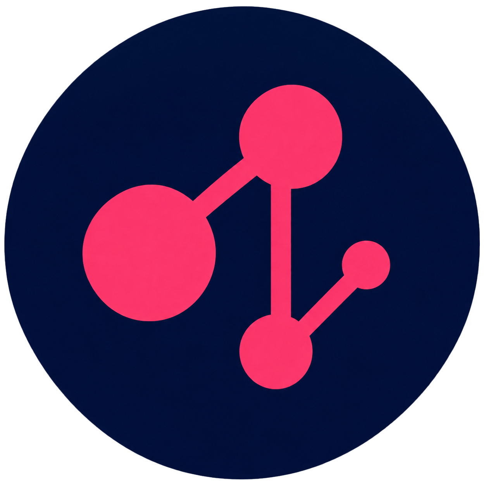

<h1 align="center">
  

</h1>

# DataBV
### Data & Analytics Solutions

**Turning data into insights, visualizations, and accessible solutions.**

DataBV is an independent data and analytics brand focused on developing practical, data-driven solutions.

Our projects combine **Business Intelligence, Data Analytics, Data Visualization, and technology** to transform complex information into clear, accessible, and actionable insights.

## What We Build

  
  <strong>Data Products</strong> 
  &nbsp;&nbsp;&nbsp; Interactive applications and data-driven tools.

  
  <strong>Business Intelligence</strong> 
  &nbsp;&nbsp;&nbsp; Dashboards, KPIs, and performance monitoring.

  
  <strong>Data Analytics</strong> 
  &nbsp;&nbsp;&nbsp; Data exploration, analysis, and meaningful insights.

  
  <strong>Data Visualization</strong> 
  &nbsp;&nbsp;&nbsp; Clear, intuitive, and engaging visual experiences.

  
  <strong>Data Projects</strong> 
  &nbsp;&nbsp;&nbsp; End-to-end solutions integrating datasets, APIs,
  and analytical workflows.

## Explore DataBV

| Channel | Link |
|---|---|
| 🌐 Website & Products | [databvstudio.com](https://databvstudio.com/) |
| 💼 LinkedIn | [DataBV](https://www.linkedin.com/company/databv) |
| 💻 GitHub | [databvstudio](https://github.com/databvstudio) |

## Development & Technical Portfolio

DataBV products and solutions are developed by **Bia Vasconcelos**, a Business Intelligence and Data Analytics professional.

For technical documentation, SQL queries, data pipelines, notebooks, and development projects, visit the developer's personal GitHub.

**Developer:** [Bia Vasconcelos](https://github.com/biavascobv)

---

**DataBV — Data & Analytics Solutions**

*Data-driven thinking. Meaningful solutions.*

© 2026 DataBV
